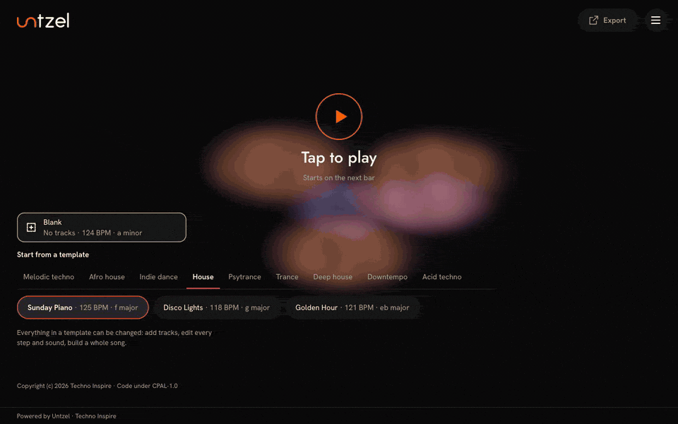
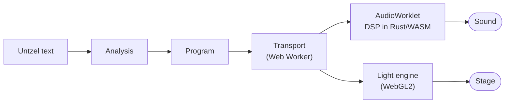

<h1 align="center">
  <picture>
    <source media="(prefers-color-scheme: dark)" srcset="brand/untzel/untzel-wordmark-dark.svg">
    
  </picture>
</h1>

<p align="center">
  An audiovisual instrument for the browser: every line of code is a layer of sound and a layer of light.
  Any style, any melody, any rhythm.
</p>

<p align="center">
  <a href="https://untzel.com">Website</a> ·
  <a href="https://untzel.com/docs">Docs</a> ·
  <a href="https://untzel.com/docs/changelog">Changelog</a>
</p>

<p align="center">
  <a href="https://github.com/technoinspire/untzel/actions/workflows/ci.yml"></a>
  <a href="LICENSE"></a>
  <a href="https://untzel.com/docs"></a>
  <a href="https://github.com/technoinspire/untzel/releases/latest"></a>
  <a href="https://scorecard.dev/viewer/?uri=github.com/technoinspire/untzel"></a>
</p>

<p align="center">
  
</p>

## What is Untzel

Untzel is a music instrument that runs in your browser, on a phone or a computer. You tap
once and a loop starts; then you change it with your fingers or by editing a short text, and
the music never stops while you do.

Every track is one line of the Untzel language. The track tiles, the song timeline and the
code editor all edit that same text, so whatever you build by touch you can read as code,
and whatever you write as code shows up as tiles. The same events that play the sound drive
the light on the stage, and the result leaves as a link, a file, a video or a WAV.

The sound is made on your device. There is no account, no server and no tracking.

## Features

- **Code, sound and light are one thing.** Each instrument has its own light scene, lit by
  the notes it plays, and the token that is sounding lights up in the code.
- **44 instruments and 167 named sounds**: drums and percussion, basses, keys, pads, leads,
  strings, voices and effects. Fifteen of them play real recordings (piano, strings, harp,
  mallet, bell, kalimba, hand percussion, clap, hat, voice and choir); the rest are
  synthesized.
- **A template library in many styles**, from a full song to a short loop, each one a
  starting point you can change line by line or replace with a blank project.
- **Protection for people who do not read music.** With a `key`, every note snaps to the
  scale, and every change waits for the next bar, so nothing lands out of time.
- **Invalid code never stops the music.** A mistake gets a mark and a message, often with a
  one-tap fix, and the last valid version keeps playing.
- **From a loop to a whole song**: sections, an arrangement, a play range and loops of 1 to
  16 bars.
- **Share and export**: a link or a `.untzel` file anyone can remix, a 9:16 story or 16:9
  video in HD (or 4K where the device can render it), and WAV audio. The attribution travels with every video.
- **Safe to paste.** The text is analyzed, never executed: no scripts, no functions, no
  imports. A ready prompt teaches an AI assistant to write Untzel for you.
- **English and Portuguese**, in the app and in the docs.

## Play

Untzel needs nothing installed. Open **[app.untzel.com](https://app.untzel.com)**, or start from
**[untzel.com](https://untzel.com)**, the home of the project. To run your own copy, see
[local development](#local-development). Tap **Tap to play**: browsers only allow sound after
a gesture, and that first tap is the only step before the music.

Supported browsers: current Chrome, Edge and Samsung Internet, Safari 26 on macOS and iOS,
and Firefox 141 or newer.

New here? [Start here](https://untzel.com/docs) walks you through your first loop in two
minutes.

## Local development

### Prerequisites

| Tool | Version | Source of truth |
|---|---|---|
| Node.js | 24, at least 24.21.0 | [`.nvmrc`](.nvmrc) and `engines` in [`package.json`](package.json) |
| pnpm | 12.8.1, installed with `npm install -g pnpm@12.8.1` (Corepack does not work with pnpm 12) | `packageManager` in [`package.json`](package.json) |
| Rust | 1.99.0 with the `wasm32-unknown-unknown` target, `rustfmt` and `clippy`; `rustup toolchain install` reads them | [`rust-toolchain.toml`](rust-toolchain.toml) |
| Google Chrome | current | the browser tests run on the installed Chrome |

### Run it

```sh
git clone https://github.com/technoinspire/untzel.git
cd untzel
pnpm install --frozen-lockfile
pnpm run doctor   # checks every tool above and says how to fix what is missing
pnpm dev          # the app at http://localhost:5173, rebuilt when the TypeScript or the Rust changes
```

### Check it

| Command | What it does |
|---|---|
| `pnpm check` | the fast gate: types, unit tests, Rust tests, layer rules, the public docs, translations and license headers |
| `pnpm check:full` | `check`, then Rust lint and format, the build, size budgets, golden files, the sound gates and the browser tests |
| `pnpm sim <file.untzel>` | plays a text without a browser and writes a WAV, the events and a report |
| `pnpm test:browser` | Playwright on the installed Chrome, with screenshots |

Contributors run `pnpm check` before every push; [`CONTRIBUTING.md`](CONTRIBUTING.md) says
when to run the others.

## The Untzel language

A text is a few global lines and one line per track: a name, an instrument, a sound, a
pattern for one bar (`/` separates bars) and modifiers after `|`.

```text
title "First light"
tempo 96
key d dorian

keys:  piano  felt    Dm7 ~ ~ ~ / G7 ~ ~ ~                  | voicing open | reverb wide
bass:  bass   round   d2 . . a1 . . d2 . / g1 . . d2 . . g1 .
kick:  kick   warm    x... ..x. x... ....
snare: snare  brush   .... x... .... x...
hat:   hat    closed  x.x. x.x. x.x. x.xx                   | gain 0.5 | swing 0.12
```

`x` is a hit and `.` a rest, `~` holds the previous note, and chords like `Dm7` are written
as they are spoken. Paste it into the Code panel, or play it with
`pnpm sim example.untzel --bars 8`. The [language guide](https://untzel.com/docs/language)
teaches one idea at a time, and the [reference](https://untzel.com/docs/reference) lists
every word.

## How it works

The text is parsed into a program, never executed. A transport in a Web Worker schedules the
program a little ahead, so a busy main thread does not delay the sound, and sends the events
to an `AudioWorklet`, where the sound engine, written in Rust and compiled to WebAssembly
with no imports, renders them sample by sample. The same events reach the light engine,
which draws the stage with WebGL2. Time is kept in exact fractions, so loops never drift.



The architecture, the threads and the instrument contract are described on the
[developers page](https://untzel.com/docs/developers) of the docs.

## Repository layout

| Folder | What lives there |
|---|---|
| [`apps/`](apps) | `web`, the app; `docs`, the public docs content; `ui-preview`, a preview of the interface |
| [`packages/`](packages) | the `@untzel/*` libraries: the core, the language, the transport, the session, the sound engine and every adapter |
| [`instruments/`](instruments) | one folder per instrument: manifest, voice and, for recorded instruments, the sample pack |
| [`tools/`](tools) | the local harness, the simulator, the docs generator, the release package, size budgets and license headers |
| [`changelog/`](changelog/README.md) | one entry per pull request, published with each release |
| [`brand/`](brand/README.md) | the Untzel and Techno Inspire marks |
| [`.github/`](.github) | workflows, issue forms and the pull request template |

## Changelog

- What changed in each release: [untzel.com/docs/changelog](https://untzel.com/docs/changelog).
- How entries are written: [`changelog/README.md`](changelog/README.md).

## Contributing

Instruments, light scenes, templates, the language, docs and translations are all open to
contributions. Read [`CONTRIBUTING.md`](CONTRIBUTING.md) first: it covers the setup, the
[engineering standards](CONTRIBUTING.md#engineering-standards), the checks, the review and the
[Contributor License Agreement](CLA.md).

## Community and support

- Questions and things you made: [Discussions](https://github.com/technoinspire/untzel/discussions).
- Bugs, sounds that are off and docs mistakes: [issue forms](https://github.com/technoinspire/untzel/issues/new/choose).
- Where to ask what: [`SUPPORT.md`](SUPPORT.md).
- Everyone who takes part follows the [Code of Conduct](CODE_OF_CONDUCT.md).

## Security

Report a vulnerability privately, never in a public issue, as [`SECURITY.md`](SECURITY.md)
explains.

## License and attribution

The code is licensed under the [Common Public Attribution License 1.0](LICENSE)
(CPAL-1.0). Every copy that runs must keep the attribution visible: the Untzel logo,
"Powered by Untzel · Techno Inspire" and the link, in the interface, the player and every
exported video. The details are in [`ATTRIBUTION.md`](ATTRIBUTION.md).

The names and logos of Untzel and Techno Inspire are trademarks of Techno Inspire, used as
[`TRADEMARKS.md`](TRADEMARKS.md) describes. Bundled third-party material (recordings and
fonts) keeps its own license, listed in [`THIRD_PARTY.md`](THIRD_PARTY.md).

## Acknowledgements

- The recordings that fifteen instruments play: [VocalSet](https://zenodo.org/records/1442513)
  (CC BY 4.0), the [Salamander Grand Piano](https://github.com/sfzinstruments/SalamanderGrandPiano)
  (CC BY 3.0), [VSCO 2 Community Edition](https://github.com/sgossner/VSCO-2-CE) and the
  [Versilian Community Sample Library](https://github.com/sgossner/VCSL) (CC0).
- The interface fonts [Hanken Grotesk](https://github.com/marcologous/hanken-grotesk) and
  [Jost](https://github.com/indestructible-type/Jost) (SIL Open Font License 1.1).
- The published techniques behind the light engine: webgl-noise, psrdnoise, Inigo Quilez's
  distance functions, Butterchurn's feedback and dual-filter bloom.
- [Strudel](https://strudel.cc), the reference for what live coding in the browser can be.
  Untzel shares no code with it.

Full credits and licenses: [`THIRD_PARTY.md`](THIRD_PARTY.md) and the
[credits page](https://untzel.com/docs/credits).

---

<p align="center">Made by <a href="https://technoinspire.com.br">Techno Inspire</a>.</p>
